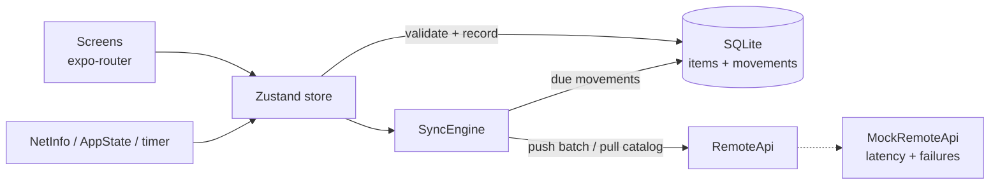

# StockPilot

**Offline-first inventory scanning app built with React Native (Expo) and TypeScript.**

Warehouse floors have dead zones. StockPilot lets an operator scan a barcode, receive or pick stock, and keep working with no signal. Every change is stored on the device first and synced to the server when a connection is available, without ever applying the same change twice.


<!-- Add screenshots / a 20-second screen recording here:
<p>
  
  
  
</p>
-->

## Features

- **Barcode scanning** with the device camera (EAN-13/8, UPC, Code 128/39, QR), plus manual entry
- **Works fully offline**: stock changes are written to SQLite and shown immediately
- **Reliable background sync** on reconnect, app foreground, pull-to-refresh and a 30-second interval
- **Exactly-once effects**: each movement carries a client-generated idempotency key
- **Server rejections are handled**: if another device took the stock first, the change is rolled back and the reason is shown
- **Clear sync state**: queued changes, unsynced quantities and per-movement status are visible to the user
- **Offline switch in the header** to demo all of the above without touching device settings

## Architecture



```
src/
  app/        screens (expo-router): inventory list, scanner, item detail
  domain/     pure business rules: validation, quantity rebasing, backoff
  data/       InventoryRepository interface, SQLite + in-memory implementations
  sync/       SyncEngine, RemoteApi interface, mock backend
  state/      Zustand store and sync triggers
  components/ presentational components
```

The domain and sync layers have **no React or Expo imports**. Storage and network sit behind interfaces, so the sync engine is tested against in-memory fakes and the mock backend can be swapped for a real HTTP client without touching business logic.

## Key design decisions

**The movement is the outbox.** A stock change is recorded once, in a single transaction with the quantity update. That same row is the queue entry the sync engine drains. There is no separate queue that could drift out of step with the data.

**Quantity is recomputed, not incremented.** Each item stores `serverQuantity`, the last value the server confirmed. The visible quantity is always `serverQuantity + sum(pending deltas)`. When the server rejects a change, or another device changes the same item, the device rebases its pending work onto the new server value and stays correct automatically.

**Idempotency keys make retries safe.** Movement ids are UUIDs generated on the device. If a request succeeds but the response is lost, the retry comes back as `duplicate` instead of being applied twice.

**Transient vs. permanent failures are handled differently.** Network failures are retried with exponential backoff and full jitter, capped at five minutes. Business rejections, such as insufficient stock, are final. They are rolled back locally and surfaced to the user.

**Single-flight sync.** Several triggers can fire at once. Concurrent `sync()` calls share one run, so batches are never sent twice in parallel.

**Stale data is ignored.** Each item carries a server version, and older snapshots never overwrite newer state.

## Tests

```bash
npm test
```

The sync engine tests cover the cases that usually break offline apps:

- pushing pending movements and confirming server quantity
- staying queued while offline, backing off, then recovering
- never applying a retried movement twice (lost response)
- rolling back a movement the server rejects
- rebasing local work on top of changes from other devices
- ignoring stale server snapshots
- sharing one run between concurrent sync calls

CI runs typecheck, lint, the unit tests and an Android production bundle on every push.

## Run it

Requires Node 22+ and a device or simulator. Camera scanning needs a physical device; manual barcode entry works everywhere.

```bash
npm install
npx expo start
```

Try it: open an item, toggle **Offline** in the header, remove some stock, and watch the change queue up. Toggle Offline back off and watch it sync. Sample barcodes are in [`src/sync/seed.ts`](src/sync/seed.ts) (for example `4006381333931`).

## Trade-offs and next steps

- **Mock backend.** The server runs in-process so the project needs no infrastructure. `RemoteApi` is the seam for a real REST or GraphQL client.
- **Lost-response window.** If a push succeeds but its response is lost, and a pull lands before the retry, that one change is briefly counted twice. The retry resolves it as `duplicate`. A server-side acknowledgment list in the pull response would close the gap.
- **Full catalog pulls.** That's fine for thousands of SKUs. Larger catalogs would need cursor-based delta sync.
- **Next steps:** Maestro E2E flows, an SQLite repository test suite on device, batch receiving against a purchase order, and a printable bin label.

## Tech

React Native 0.88 · Expo SDK 58 · TypeScript (strict) · expo-router · expo-sqlite · expo-camera · Zustand · NetInfo · Jest · GitHub Actions

## License

MIT
